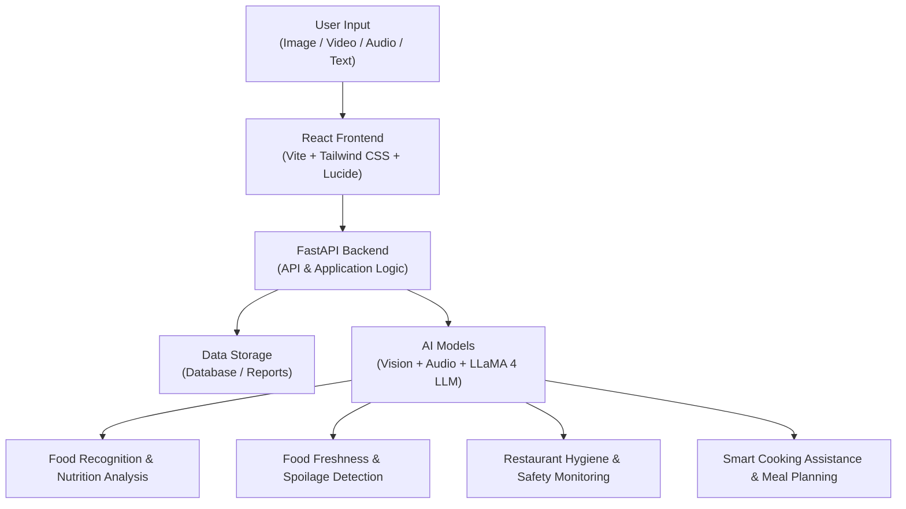

# FoodVerse AI - Multimodal Food Intelligence Agent

**FoodVerse AI** is a multimodal, AI-powered food intelligence platform that integrates computer vision, audio analysis, and large language model-driven reasoning to deliver real-time insights across food recognition, freshness detection, restaurant hygiene monitoring, smart cooking assistance, and personalized nutrition planning.

---

## 🏛️ Architecture & Modules



---

## 🚀 Key Modules & Capabilities

1. **Multimodal Food Lens & Nutrition Analysis** (`/food-recognition`)
   - Identifies dishes using multimodal vision, voice description notes, and text context.
   - Calculates calorie content, protein, carbs, fats, fiber, and sugar.
   - Computes an overall composite health score (0–100) and recommends healthier culinary alternatives.
   - Powered by `meta-llama/llama-4-scout-17b-16e-instruct` and vision reasoning models.

2. **AI Freshness & Spoilage Detector** (`/freshness-detector`)
   - Analyzes visual indicators (enzymatic discoloration, mold spores, textural shriveling, loss of turgor).
   - Incorporates sensory metadata (storage duration, storage type: Room Temp, Fridge, Freezer, Pantry).
   - Outputs strict safety status (`SAFE TO EAT`, `UNSAFE`, or `CONSUME SOON`), confidence percentage, detected visual signs, and consumption recommendations.

3. **Hygiene & Safety Surveillance Monitor** (`/hygiene-monitor`)
   - Real-time kitchen compliance inspection from CCTV footage or camera frames.
   - Evaluates adherence to sanitary standards (gloves usage, hairnet compliance, clean floor index, phone use).
   - Real-time compliance scoring with violation alerts.
   - Instant downloadable ISO 22000 / HACCP-compliant inspection PDF report.

4. **Smart Kitchen & Recipe Generator** (`/kitchen-assistant`)
   - Contextual cooking guidance from text descriptions of pantry items or uploaded dish photos.
   - Outputs exact ingredient list with measurements and structured step-by-step preparation procedures.

5. **Personalized Meal Planner & AI Coach** (`/meal-planner`)
   - Profile processing: age, gender, height, weight, activity level, health goals, medical conditions, cuisine preferences, and critical allergen safeguards.
   - Generates complete daily schedules (Breakfast, Mid-Morning Snack, Lunch, Evening Snack, Dinner) with precise caloric and macronutrient targets.
   - 7-Day Weekly Overview and adaptive AI Coach Report with consistency checks and motivational advice.

---

## 📂 Project Structure

```
foodverse-ai/
├── backend/
│   ├── main.py                     # FastAPI server & CORS configuration
│   ├── requirements.txt            # Python dependencies
│   ├── .env                        # Groq API key & Model configurations
│   ├── test_api.py                 # Automated test suite for all 7 endpoints
│   ├── temp_uploads/               # Upload buffer & generated PDF reports
│   └── routers/
│       ├── __init__.py
│       ├── food_recognition.py     # Multimodal food recognition & nutrition API
│       ├── freshness_detector.py   # Spoilage & freshness classification API
│       ├── hygiene_monitor.py      # Kitchen CCTV compliance & PDF report API
│       ├── kitchen_assistant.py    # Recipe generator & cooking guidance API
│       └── meal_planner.py         # Clinical-grade personalized nutrition API
├── frontend/
│   ├── package.json                # React, Vite, Lucide-React, Tailwind
│   ├── vite.config.js
│   ├── tailwind.config.js
│   ├── index.html
│   └── src/
│       ├── App.jsx                 # Route navigation configuration
│       ├── main.jsx
│       ├── index.css
│       ├── utils/
│       │   ├── cn.js               # Tailwind class merger
│       │   └── audioRecorder.js    # Browser Web Audio MediaRecorder
│       ├── components/
│       │   └── Layout.jsx          # Dark slate sidebar with system status
│       └── pages/
│           ├── Dashboard.jsx        # FoodVerse Overview & module launcher
│           ├── FoodRecognition.jsx  # Multimodal food lens interface
│           ├── FreshnessDetector.jsx# AI Freshness & spoilage check
│           ├── HygieneMonitor.jsx   # CCTV surveillance & live insights
│           ├── KitchenAssistant.jsx # Smart recipe generator
│           └── MealPlanner.jsx      # Personalized meal planner & coach
├── run_project.bat                 # One-click Windows startup script
├── run_project.ps1                 # PowerShell startup script
└── README.md
```

---

## 🛠️ Quick Start Instructions

### 1. Backend Setup

```bash
cd backend

# Activate virtual environment (already configured):
.\venv\Scripts\activate

# (Optional) Add your Groq API key in .env for live LLM inference:
# GROQ_API_KEY=your_key_here

# Run the FastAPI server:
python main.py
```
> Backend runs at: `http://localhost:8000`
> Interactive API Docs (Swagger UI): `http://localhost:8000/docs`

### 2. Frontend Setup

```bash
cd frontend

# Install packages (already installed):
npm install

# Start Vite dev server:
npm run dev
```
> Web Dashboard runs at: `http://localhost:5173`

---

## 🧪 Validation & Automated Testing

To run the automated verification test suite covering all 7 API endpoints:

```bash
cd backend
.\venv\Scripts\python.exe test_api.py
```
Outputs:
```text
--- 1. Testing Root Endpoint ---
Root response: {'message': 'Welcome to FoodVerse AI API', 'status': 'active', 'api_key_set': False}
--- 2. Testing Food Recognition ---
Food recognition response dish: Chicken Biryani Calories: 720
--- 3. Testing Freshness Detector ---
Freshness response: Banana Spoiled Unsafe
--- 4. Testing Hygiene Monitor ---
Hygiene score: 40 Violations: 2
--- 5. Testing Hygiene PDF Report Download ---
PDF Report downloaded successfully, bytes: 1757
--- 6. Testing Kitchen Assistant Recipe Generator ---
Recipe generated: Chicken Biryani Steps: 7
--- 7. Testing Meal Planner ---
Breakfast: Avocado Toast with Poached Eggs
Lunch: Grilled Chicken and Vegetable Wrap
Dinner: Quinoa and Black Bean Bowl with Grilled Salmon

>>> ALL 7 FOODVERSE AI ENDPOINTS PASSED WITH 100% SUCCESS <<<
```
